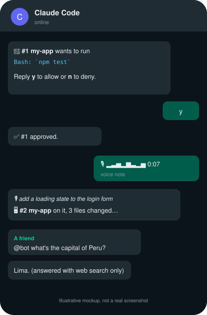
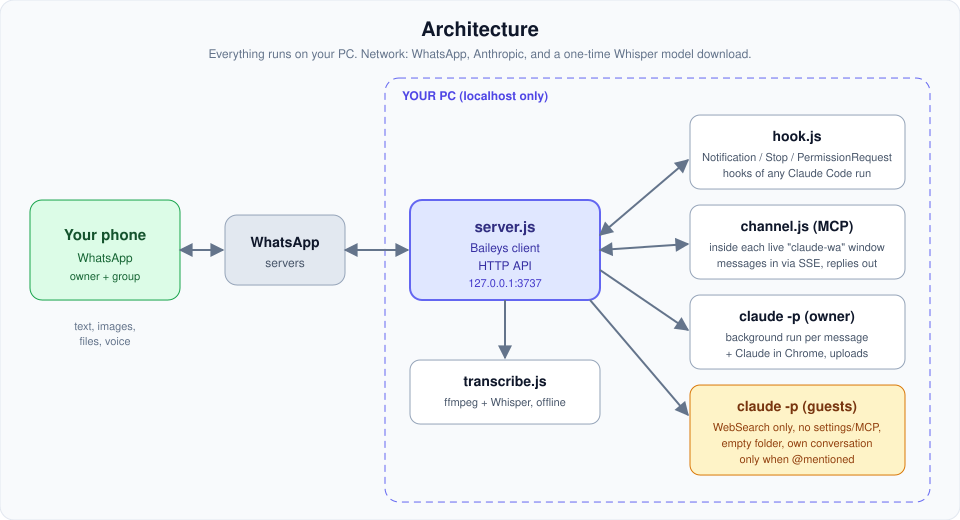
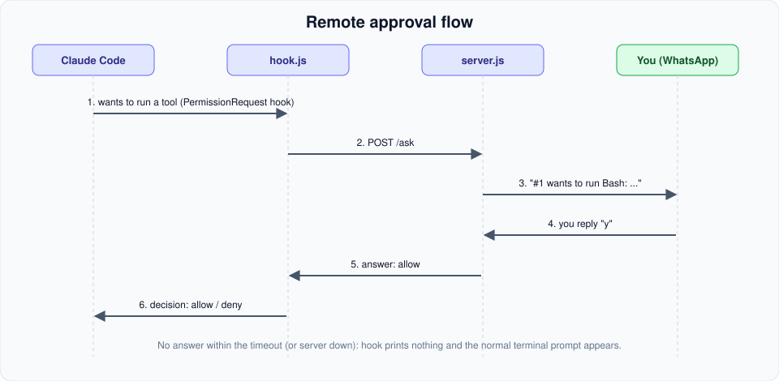

<h1 align="center">claude-whatsapp-notify</h1>

<p align="center">
  <b>Control <a href="https://claude.com/claude-code">Claude Code</a> from WhatsApp.</b><br>
  Approve commands, send prompts and voice notes, and chat with your open sessions from your phone.
</p>

<p align="center">
  
  
  
  
</p>

<p align="center">
  
</p>

Get notified when Claude needs you, approve or deny commands from your phone, send prompts (text, images, files, voice notes) straight into your open Claude Code sessions, and let friends in a group chat ask questions without being able to run anything on your PC.

Everything runs locally on your machine. The outside connections are WhatsApp (via [Baileys](https://github.com/WhiskeySockets/Baileys)), Anthropic (via Claude Code) and a one-time Whisper model download from Hugging Face.

> ⚠️ Baileys is an **unofficial** WhatsApp client. WhatsApp's terms don't allow unofficial clients, so use a secondary number for the bot — it could get banned.

## Features

- 🔔 **Notifications** — permission prompts, idle sessions, and "task finished" summaries (with Claude's last reply)
- 🔐 **Remote approvals** — reply `y` / `n` to approve or deny a tool call
- 🖥️ **Live sessions** — start Claude Code with `claude-wa` and talk to that exact window from WhatsApp, with its folder, history and context; switch between several windows
- 🧠 **Background runs** — when no window is connected, each message runs `claude -p` and continues the same conversation
- 🖼️ **Images & files** — send a screenshot or PDF and Claude reads it
- 🎙️ **Voice messages** — transcribed locally with Whisper (no extra service), then sent to Claude
- 🌐 **Claude in Chrome** — owner-only browser automation
- 👥 **Group chat with guests** — other members get a locked-down Claude (web search only, no tools that touch your PC, separate conversation); the bot only answers when @mentioned or replied to

## How it works

<p align="center">
  
</p>

### Approval flow

<p align="center">
  
</p>

| File | Role |
|---|---|
| `server.js` | WhatsApp connection, command handling, local HTTP API, background and guest runs |
| `hook.js` | Forwards Claude Code hook events to the server; exits silently if it isn't running |
| `channel.js` | [Claude Code channel](https://code.claude.com/docs/en/channels-reference) that pipes WhatsApp messages into a live session and relays permission prompts |
| `transcribe.js` | Local voice-note transcription (ffmpeg + Whisper via transformers.js) |
| `bin/claude-wa*` | Launch Claude Code with the WhatsApp channel (paths are derived from the install location) |

## Setup

Requires Node.js 18+ and Claude Code. Clone the repo anywhere; below, `<install-dir>` is wherever you cloned it. If the `claude` binary isn't on your `PATH` (or in `~/.local/bin`), set `CLAUDE_EXE` to its full path.

1. **Install and start the server**
   ```
   npm install
   npm start
   ```
   Scan the QR code with the bot's WhatsApp (Settings → Linked devices). The console prints a code — send `link <code>` to the bot from your personal WhatsApp.

2. **Add the hooks** to `~/.claude/settings.json`:
   ```json
   "hooks": {
     "Notification": [{ "hooks": [{ "type": "command", "command": "node \"<install-dir>/hook.js\" notification", "timeout": 15 }] }],
     "Stop": [{ "hooks": [{ "type": "command", "command": "node \"<install-dir>/hook.js\" stop", "timeout": 15 }] }],
     "PermissionRequest": [{ "hooks": [{ "type": "command", "command": "node \"<install-dir>/hook.js\" permission", "timeout": 600 }] }]
   }
   ```

3. **Live sessions (optional)** — add `<install-dir>/bin` to your `PATH` (don't copy the scripts out of it; they locate the project relative to themselves), then start Claude Code with `claude-wa` (`claude-wa.cmd` on Windows, `bin/claude-wa` on macOS/Linux/Git Bash). Choose *"I am using this for local development"* at the channel warning. To avoid a prompt for every reply, add `mcp__whatsapp__reply` to your allowed tools via `/permissions`.

## WhatsApp commands

| Command | Does |
|---|---|
| *(any other message)* | Prompt for the selected session (or a background run) |
| `sessions` / `switch <n>` / `switch bg` | List and pick live Claude Code windows |
| `new` · `cd <folder>` · `where` · `stop` | Background runs: fresh conversation, change folder, show folder, cancel |
| `away` / `back` | Ask on WhatsApp before tools run / go back to the terminal |
| `y` / `n` (`y 3`) | Approve or deny the oldest (or a specific) pending request |
| `use this group` / `use dm` | Move the bot into a group chat / back to the private chat |
| `guests on` / `guests off` / `guests new` | Let group members ask questions / stop them / reset their conversation |
| `voice en` / `voice fr` / `voice ar` | Language for voice-note transcription |
| `status` · `help` | Current mode and pending requests · command list |

## Privacy & security

- Only the linked owner can send prompts, approve tools, or use Claude in Chrome. Guest messages go to a Claude with no command, file or browser tools, running in an empty folder with no settings, hooks or MCP servers loaded.
- Claude Code adds the account email to every session's context. Guests are instructed never to reveal personal details, but that's an instruction, not a hard guarantee.
- Group messages that don't @mention or reply to the bot are dropped locally and never sent to Claude.
- The local API only listens on `127.0.0.1`.
- Not committed: `auth/` (WhatsApp login), `config.json` (linked numbers, settings), `uploads/` (received files).

### Known limitations

Read these before relying on it. This is a personal tool and hasn't had an external security audit.

- **The local API has no authentication.** Any process on your PC (or a web page that can reach `localhost:3737`) can send you messages or register as a session. Don't use it on a shared machine.
- **Approval previews are truncated** to 1,500 characters. A very long command can hide its tail, so deny anything that looks cut off.
- **In group mode, everything goes to the group.** Approval prompts, replies and "finished" summaries are visible to every member. Guests can't approve anything, but they can read it.
- **Pairing code** has no attempt limit or expiry; only start the server when you're about to pair.
- **Guest isolation** relies on the Claude Code flags in `server.js` (`--restricted`, `--tools WebSearch`, empty settings). Check them against your Claude Code version.

## License

[ISC](LICENSE) © Haidar Esber
